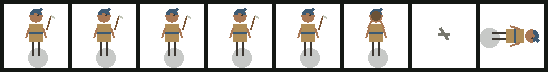
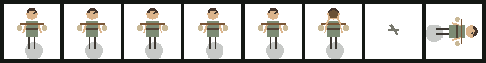
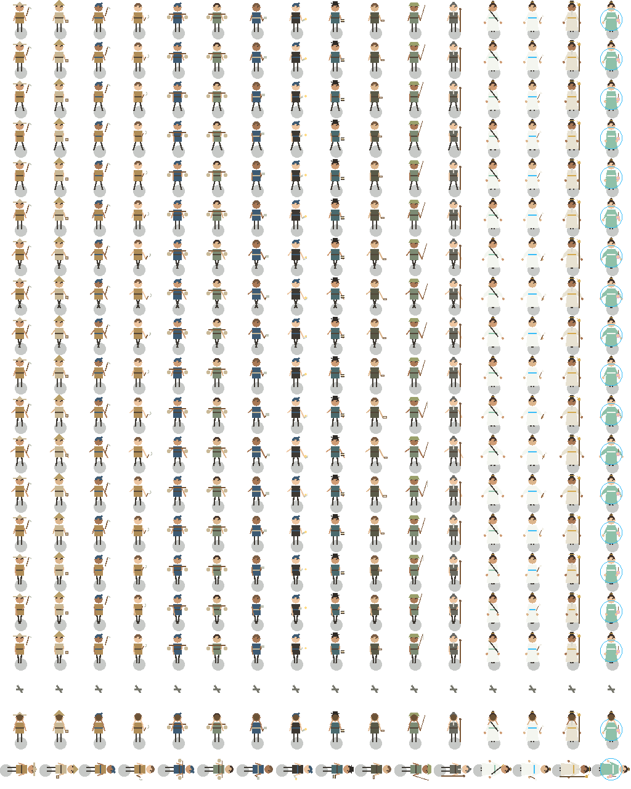
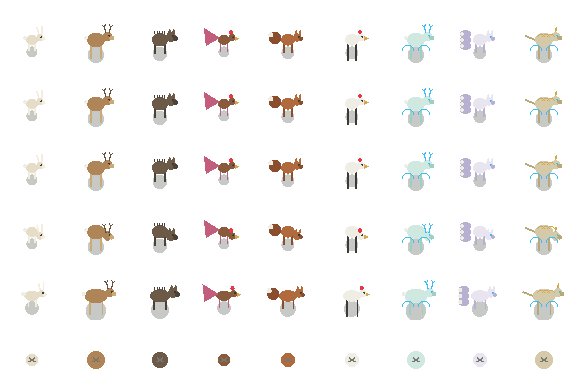
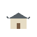
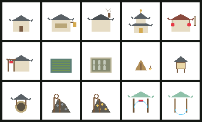
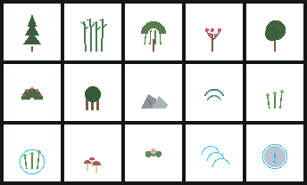

# NEAT Xianxia — Parked Asset Catalog

**Runtime** files are loaded by Godot. **Parked** files are source
art, contact sheets, or assets awaiting integration.
The use column includes planned uses. Regenerate with
`python3 assets/tools/gen_assets.py && python3 assets/tools/build_catalog.py`.

## `villager-atlas-v2`

Villager atlas v2 — `atlas.png` (1024×1280), 16 cols × 20 pose rows. Stance sheets per figure show: idle, walk×2, work×2, carry, dead, lying.

| ID | Image | Runtime status | Current or planned use |
|---|---|---|---|
| `villager-atlas-v2/farmer-straw` |  | Parked | Atlas col 0 — farmers on Farm/HarvestRice actions |
| `villager-atlas-v2/farmer-douli` |  | Parked | Atlas col 1 — gatherers, ForageMeal |
| `villager-atlas-v2/fieldhand` |  | Parked | Atlas col 2 — WorkForFood laborers |
| `villager-atlas-v2/reaper` |  | Parked | Atlas col 3 — harvest workers |
| `villager-atlas-v2/porter` |  | Parked | Atlas col 4 — Deliver/Trade carriers |
| `villager-atlas-v2/laborer` |  | Parked | Atlas col 5 — Build/construction crews |
| `villager-atlas-v2/artisan` |  | Parked | Atlas col 6 — CraftTool artisans |
| `villager-atlas-v2/smith` |  | Parked | Atlas col 7 — blacksmith workshop |
| `villager-atlas-v2/merchant` |  | Parked | Atlas col 8 — OperateBusiness shopkeepers |
| `villager-atlas-v2/trader` |  | Parked | Atlas col 9 — Trade/Barter at market |
| `villager-atlas-v2/fisher` |  | Parked | Atlas col 10 — coastal fish gatherers |
| `villager-atlas-v2/elder` |  | Parked | Atlas col 11 — elderly villagers |
| `villager-atlas-v2/swordsman` |  | Parked | Atlas col 12 — cultivator (dormant) |
| `villager-atlas-v2/cultivator` |  | Parked | Atlas col 13 — robed cultivator (dormant) |
| `villager-atlas-v2/elder-sage` |  | Parked | Atlas col 14 — elder sage (dormant) |
| `villager-atlas-v2/spirit-envoy` |  | Parked | Atlas col 15 — spirit envoy (dormant) |
| `villager-atlas-v2/atlas` |  | Runtime | Full atlas grid |

## `animal-table-xianxia`

Animal stance sheets — idle, walk×2, graze, flee, dead. `atlas.png` = 9×6 grid.

| ID | Image | Runtime status | Current or planned use |
|---|---|---|---|
| `animal-table-xianxia/rabbit` |  | Parked | Wildlife renderer — grove herbivore (existing) |
| `animal-table-xianxia/deer` |  | Parked | Wildlife renderer — grove herbivore (existing) |
| `animal-table-xianxia/boar` |  | Parked | Future species — forest forager |
| `animal-table-xianxia/pheasant` |  | Parked | Future species — grove bird |
| `animal-table-xianxia/fox` |  | Parked | Future species — first predator |
| `animal-table-xianxia/crane` |  | Parked | Future species — coast/wetland bird |
| `animal-table-xianxia/spirit-deer` |  | Parked | Dormant immortal-tier spirit beast |
| `animal-table-xianxia/spirit-fox` |  | Parked | Dormant immortal-tier spirit beast |
| `animal-table-xianxia/qilin-colt` |  | Parked | Dormant rare spirit beast |
| `animal-table-xianxia/atlas` |  | Runtime | Full atlas grid |

## `site-glyphs-xianxia`

Building & site glyphs (64×64).

| ID | Image | Runtime status | Current or planned use |
|---|---|---|---|
| `site-glyphs-xianxia/home` |  | Runtime | Housing blocks in `field.gd` |
| `site-glyphs-xianxia/shop` |  | Parked | Shop buildings (clothes/tools/furniture/butcher sign variants) |
| `site-glyphs-xianxia/workshop` |  | Parked | Workshop buildings (hunter/cobbler/blacksmith/carpenter) |
| `site-glyphs-xianxia/bank` |  | Runtime | Town bank — pagoda landmark |
| `site-glyphs-xianxia/tavern` |  | Runtime | Village tavern — lantern landmark |
| `site-glyphs-xianxia/school` |  | Runtime | School — paifang gate |
| `site-glyphs-xianxia/farm` |  | Runtime | Rice farm plots |
| `site-glyphs-xianxia/graveyard` |  | Runtime | Graveyard — stele rows |
| `site-glyphs-xianxia/shelter` |  | Runtime | Roadside camps |
| `site-glyphs-xianxia/jobboard` |  | Runtime | Job posting board |
| `site-glyphs-xianxia/market` |  | Runtime | Market centre well |
| `site-glyphs-xianxia/mine-iron` |  | Runtime | Iron mine — headframe + ore |
| `site-glyphs-xianxia/mine-gold` |  | Runtime | Gold mine (silver/copper share the glyph, ore color swaps) |
| `site-glyphs-xianxia/gate` |  | Parked | Immortal site — mountain gate (dormant) |
| `site-glyphs-xianxia/pavilion` |  | Parked | Immortal site — pavilion (dormant) |
| `site-glyphs-xianxia/sheet` |  | Parked | Contact sheet |

## `terrain-flora-xianxia`

Terrain, patch and flora glyphs (64×64).

| ID | Image | Runtime status | Current or planned use |
|---|---|---|---|
| `terrain-flora-xianxia/pine` |  | Runtime | Forest canopy archetype (cool groves) |
| `terrain-flora-xianxia/bamboo` |  | Runtime | Forest canopy archetype (coastal-biased) |
| `terrain-flora-xianxia/willow` |  | Runtime | Forest canopy archetype (near water/valley) |
| `terrain-flora-xianxia/plum` |  | Runtime | Rare accent tree (~1 in 7 groves) |
| `terrain-flora-xianxia/tree-generic` |  | Runtime | Default grove tree |
| `terrain-flora-xianxia/berries` |  | Runtime | Berry patch (kind 0) — dots scale with stock |
| `terrain-flora-xianxia/timber` |  | Runtime | Timber patch (kind 1) |
| `terrain-flora-xianxia/stone` |  | Runtime | Stone outcrop (kind 2) |
| `terrain-flora-xianxia/fish` |  | Runtime | Fish shoal (kind 3) |
| `terrain-flora-xianxia/herbs` |  | Parked | Future patch kind — herb forage |
| `terrain-flora-xianxia/spirit-herbs` |  | Parked | Future rare patch kind — spirit herb |
| `terrain-flora-xianxia/mushrooms` |  | Parked | Future patch kind — forest mushrooms |
| `terrain-flora-xianxia/lotus` |  | Parked | Coast-edge accent flora |
| `terrain-flora-xianxia/mist` |  | Parked | Qi mist wisps — immortal-site ambience |
| `terrain-flora-xianxia/unknown-site` |  | Parked | Undiscovered site marker — procedural-expansion engine |
| `terrain-flora-xianxia/sheet` |  | Parked | Contact sheet |

## `icons-brush`

Brush-stroke panel icons (24×24).

| ID | Image | Runtime status | Current or planned use |
|---|---|---|---|
| `icons-brush/berries` |  | Runtime | Resource menus / ledgers — food good |
| `icons-brush/timber` |  | Runtime | Resource menus — material good |
| `icons-brush/stone` |  | Parked | Resource menus — material good |
| `icons-brush/fish` |  | Parked | Resource menus — food good |
| `icons-brush/gold` |  | Runtime | Resource menus — ore good |
| `icons-brush/silver` |  | Runtime | Resource menus — ore good |
| `icons-brush/copper` |  | Runtime | Resource menus — ore good |
| `icons-brush/iron` |  | Runtime | Resource menus — ore good |
| `icons-brush/rice` |  | Parked | Resource menus — food good |
| `icons-brush/axe` |  | Parked | Tool inventories |
| `icons-brush/pickaxe` |  | Parked | Tool inventories |
| `icons-brush/hoe` |  | Parked | Tool inventories / farm jobs |
| `icons-brush/shovel` |  | Parked | Tool inventories |
| `icons-brush/home` |  | Parked | Inspector title — housing |
| `icons-brush/shop` |  | Parked | Inspector title — shops |
| `icons-brush/workshop` |  | Parked | Inspector title — workshops |
| `icons-brush/bank` |  | Parked | Inspector title — bank |
| `icons-brush/school` |  | Parked | Inspector title — school |
| `icons-brush/tavern` |  | Parked | Inspector title — tavern |
| `icons-brush/farm` |  | Parked | Inspector title — farm |
| `icons-brush/graveyard` |  | Parked | Inspector title — graveyard |
| `icons-brush/shelter` |  | Parked | Inspector title — camps |
| `icons-brush/jobboard` |  | Parked | Job board panel |
| `icons-brush/market` |  | Parked | Market inspector |
| `icons-brush/road` |  | Parked | Road inspector |
| `icons-brush/sword` |  | Parked | Hunt / cultivator actions (dormant) |
| `icons-brush/scroll` |  | Parked | School / contract rows |
| `icons-brush/lantern` |  | Parked | Tavern / night rows |
| `icons-brush/ingot` |  | Parked | Treasury / bank balances |
| `icons-brush/lotus` |  | Parked | Spirit-site rows (dormant) |
| `icons-brush/seal` |  | Parked | UI signature stamp (cinnabar seal) |
| `icons-brush/sheet` |  | Parked | Contact sheet |

## `discovery-fx`

Mist & reveal animation frames.

| ID | Image | Runtime status | Current or planned use |
|---|---|---|---|
| `discovery-fx/reveal` |  | Parked | 4-frame expanding-ring reveal + qi wisps — procedural-expansion engine (art-spec §9) |
