# NEAT Xianxia — LOD Asset Board

Pre-integration review of all drawable objects at the three gameplay fidelities (L1 overview dots/landmarks, L2 drawn individuals, L3 animation). Animated previews are APNG files; open `assets/LOD_BOARD.html` for the live board.

## Settlements

Stage shapes match the live LOD1 markers in `field.gd`; at LOD2+ the market well and housing ring draw in full.

| ID | L1 | L2 | L3 | Notes |
|---|---|---|---|---|
| `settlement-camp` |  |  |  | LOD1 shape is the live field.gd marker; market well + housing ring drawn at LOD2+ |
| `settlement-village` |  | 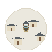 |  | LOD1 shape is the live field.gd marker; market well + housing ring drawn at LOD2+ |
| `settlement-town` |  |  |  | LOD1 shape is the live field.gd marker; market well + housing ring drawn at LOD2+ |
| `market-well` |  |  |  | Well ripple + bucket bob at LOD3 |

## Buildings & sites

Glyph = parked `site-glyphs-xianxia` texture. LOD3 adds a per-site ambient accent (smoke, lantern glow, swinging sign, turning mill wheel).

| ID | L1 | L2 | L3 | Notes |
|---|---|---|---|---|
| `home` |  | 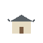 |  | Housing blocks + kind-0 urban buildings |
| `shop-clothes` |  |  |  | kind 1, line 0 |
| `shop-tools` |  | 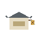 |  | kind 1, line 1 |
| `shop-furniture` |  | 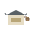 |  | kind 1, line 2 |
| `shop-butcher` |  |  |  | kind 1, line 3 |
| `workshop-hunter` |  | 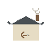 | 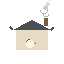 | kind 2, line 0 |
| `workshop-cobbler` |  | 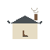 | 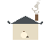 | kind 2, line 1 |
| `workshop-blacksmith` |  | 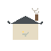 | 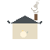 | kind 2, line 2 |
| `workshop-carpenter` |  | 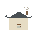 | 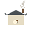 | kind 2, line 3 |
| `bank` |  |  |  | town bank, rate label |
| `tavern` |  |  | 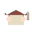 | visitors/32 + lantern landmark |
| `school` |  | 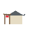 | 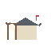 | paifang gate landmark |
| `farm` |  |  |  | mature vs growing paddy |
| `graveyard` |  |  | 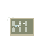 | buried_count/capacity steles |
| `shelter` |  |  | 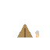 | bed occupancy ring |
| `jobboard` |  | 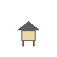 | 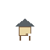 | vacancies + nearby bodies dot |
| `mine-gold` |  |  |  | patch kind 4 |
| `mine-silver` |  | 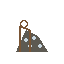 |  | patch kind 5 (reuses mine glyph today) |
| `mine-copper` |  |  | 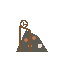 | patch kind 6 (reuses mine glyph today) |
| `mine-iron` |  | 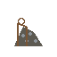 |  | patch kind 7 |
| `gate` |  | 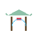 | 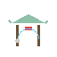 | immortal site — dormant |
| `pavilion` |  |  |  | immortal site — dormant |

## Resource patches

LOD1 keeps the in-game convention: color dots scale with stock, mines are ore-colored diamonds.

| ID | L1 | L2 | L3 | Notes |
|---|---|---|---|---|
| `patch-berries` |  |  |  | dots scale with stock |
| `patch-timber` |  | 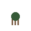 |  | larger crown radius |
| `patch-stone` |  |  |  | resource patch |
| `patch-fish` |  |  |  | coastal food source |
| `patch-gold` |  |  |  | mine diamond at LOD1 |
| `patch-silver` |  |  | 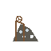 | resource patch |
| `patch-copper` |  |  |  | resource patch |
| `patch-iron` |  |  | 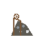 | resource patch |
| `patch-herbs` |  |  |  | dormant — future kind |
| `patch-spirit-herbs` |  |  |  | dormant — rare qi herb |
| `patch-mushrooms` | 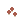 |  |  | dormant — future kind |

## Flora & terrain features

Tree canopies sway, water ripples, mist drifts. Features that the engine draws procedurally (roads, coast, hill, fog) get LOD2 cells under `parked/lod/anim/`.

| ID | L1 | L2 | L3 | Notes |
|---|---|---|---|---|
| `pine` |  |  |  | cool groves |
| `bamboo` |  | 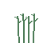 |  | coastal groves |
| `willow` |  |  |  | waterside groves |
| `plum` |  | 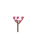 |  | ~1 in 7 accent |
| `tree-generic` |  |  |  | default grove tree |
| `forest-grove` |  |  |  | canopy layer + floor, every-3rd tree at LOD1 |
| `grass` |  |  |  | grazing regrowth for wildlife |
| `fertility` |  |  |  | farm placement tint |
| `hill` | 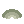 |  |  | classic terrain landmark |
| `coast` |  |  |  | shore + waterline waves |
| `river` |  |  |  | generated-map watercourse |
| `road` |  |  |  | polyline corridor; dashed when unbuilt |
| `lotus` |  |  |  | coast-edge accent flora |
| `mist` |  |  | 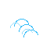 | immortal-site ambience |
| `unknown-site` |  |  |  | procedural-expansion marker |
| `fog` |  |  |  | explored-chunk fog layer |

## People

LOD1 is the existing action-colored dot (MultiMesh quad); LOD2 shows the villager-atlas stance sheet; LOD3 is the 8-frame walk cycle. Work-cycle strips ship alongside as `anim/<id>-work.png`.

| ID | L1 | L2 | L3 | Notes |
|---|---|---|---|---|
| `action-dots` |  |  |  | LOD1 person dot is colored by current action: Rest, Gather, Deliver, Buy food, Build, Trade / other, Sleeping, Dead |
| `farmer-straw` |  | 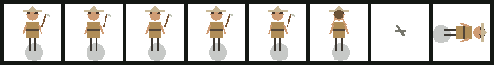 | 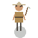 | atlas col 0; work cycle strip also emitted |
| `farmer-douli` |  |  |  | atlas col 1; work cycle strip also emitted |
| `fieldhand` |  | 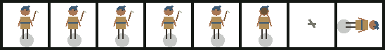 | 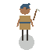 | atlas col 2; work cycle strip also emitted |
| `reaper` |  | 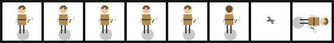 |  | atlas col 3; work cycle strip also emitted |
| `porter` |  | 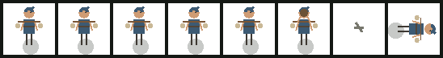 | 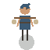 | atlas col 4; work cycle strip also emitted |
| `laborer` |  | 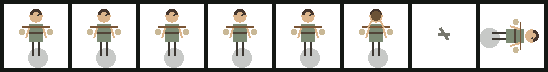 |  | atlas col 5; work cycle strip also emitted |
| `artisan` |  | 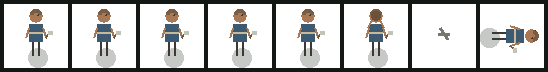 |  | atlas col 6; work cycle strip also emitted |
| `smith` |  | 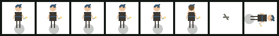 |  | atlas col 7; work cycle strip also emitted |
| `merchant` |  | 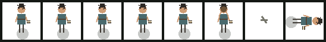 |  | atlas col 8; work cycle strip also emitted |
| `trader` |  | 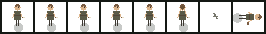 | 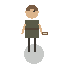 | atlas col 9; work cycle strip also emitted |
| `fisher` |  | 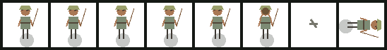 | 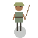 | atlas col 10; work cycle strip also emitted |
| `elder` |  |  |  | atlas col 11; work cycle strip also emitted |
| `swordsman` |  |  |  | atlas col 12; work cycle strip also emitted |
| `cultivator` |  |  |  | atlas col 13; work cycle strip also emitted |
| `elder-sage` |  |  |  | atlas col 14; work cycle strip also emitted |
| `spirit-envoy` |  |  |  | atlas col 15; work cycle strip also emitted |

## Wildlife

LOD1 species dot (size/color per `field.gd`); LOD3 is the 4-frame walk cycle. Graze/flee/dead rows already exist in the animal atlas.

| ID | L1 | L2 | L3 | Notes |
|---|---|---|---|---|
| `rabbit` |  |  |  | atlas col 0; graze/flee/dead rows exist in atlas |
| `deer` |  | 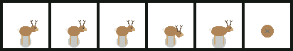 |  | atlas col 1; graze/flee/dead rows exist in atlas |
| `boar` | 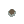 | 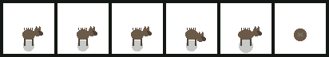 |  | atlas col 2; graze/flee/dead rows exist in atlas |
| `pheasant` |  |  |  | atlas col 3; graze/flee/dead rows exist in atlas |
| `fox` |  |  |  | atlas col 4; graze/flee/dead rows exist in atlas |
| `crane` |  |  |  | atlas col 5; graze/flee/dead rows exist in atlas |
| `spirit-deer` |  |  |  | atlas col 6; graze/flee/dead rows exist in atlas |
| `spirit-fox` |  |  |  | atlas col 7; graze/flee/dead rows exist in atlas |
| `qilin-colt` |  |  |  | atlas col 8; graze/flee/dead rows exist in atlas |

## Overlays & FX

Interface marks: convoys, rally points, zones, selection, trade routes and the discovery reveal.

| ID | L1 | L2 | L3 | Notes |
|---|---|---|---|---|
| `convoy` |  |  |  | cart + member count; LOD1-only draw today |
| `rally` |  |  |  | pre-departure gathering marker |
| `selection` |  |  |  | person/animal/site focus ring |
| `zone-residential` |  |  |  | show_zones overlay |
| `zone-commercial` |  |  |  | show_zones overlay |
| `zone-industrial` |  |  |  | show_zones overlay |
| `trade-route` |  |  |  | cumulative road cargo overlay |
| `reveal` |  |  |  | existing 4-frame fx contract |
