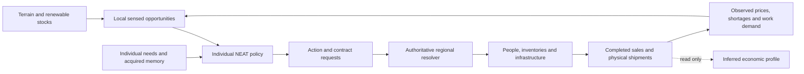

# NEAT Xianxia: a million individual minds and an emerging world

## Objective and architectural decision

The companion [TECH_STACK_DECISION.md](TECH_STACK_DECISION.md) selects Rust + packed arrays/Rayon for the headless core, Godot for the viewer, and Python for experiments, with GPU inference conditional on profiling.

Build toward **1.2 million simultaneously living, individually identifiable, brain-bearing agents**, with environment-dependent production, organic settlement growth, overland and maritime trade, and political organization. This is a development plan, not a claim that the current prototype supports that scale.

Every counted agent retains an individual NEAT genotype, phenotype, needs, inventory claims and acquired state. Terrain cells, fish biomass, buildings and decorative dots do not count toward the brain-bearing population. Identical inherited genomes may share immutable storage, but the capacity benchmark must also cover a population with distinct weights and highly diverse topologies. One million copies of one controller is not the acceptance test.

Recommended direction: a **headless native simulation core**, initially Rust with packed component arrays and region ownership, plus a separate viewer. Keep the browser simulation as an executable behavioral reference and experiment UI. Benchmark the native CPU design before selecting an optional GPU backend; do not assume a framework's simple-agent benchmark predicts this economy's performance. The reference hardware envelope is 16 physical CPU cores and 32 GiB RAM, with an optional GPU measured separately. These are proposed benchmark conditions, not a hardware purchase recommendation or measured guarantee.

Three distinctions are essential:

1. A caravan, village, town or city describes a settlement's observed organization. Building capacity and institutions change through actual work; a label grants nothing.
2. A country is a polity with jurisdiction, institutions and member settlements. It is not the next population stage of a city.
3. Economic specialization is a read-only inference from completed product sales and transport activity. There is no authoritative `economy_type = fishing_port` variable controlling production, agents or recipes.

## What to retain and what to replace

Retain from Willow Crossing: authoritative inventory transfers, escrow-backed orders, resource provenance, inputs-to-output recipes, explicit labor, travel, mortality, jobs as preferences, leadership funding, and conscription's civilian opportunity cost. Its 29 tests provide initial semantic regression cases, not a scaling test.

Replace global object scans, per-frame decisions, mutable JavaScript object graphs, global offer filtering, whole-world rendering, fixed construction sequences, fixed prices and a single camp-centered warehouse. The current live sim has utility policies, not NEAT inference; the earlier architecture lab has exploratory crossover, not a complete NEAT implementation.

The accessible Python checkout `C:\Workspace\XianXia` supplies settlement/clan concepts, cultivation realms, entity identifiers and an existing Godot project. Reuse domain vocabulary, adapters and selected fixtures. Do not carry forward `SimpleSettlement.produce_resources()` population/terrain-based stock increases or population-cap/time-based `upgrade()`/`promote_by_time()` as production or growth rules. They would bypass the environment and infrastructure constraints. Deprecate `KINGDOM` as a settlement stage and map it to a separate polity model.

## 1. Runtime architecture

**Packed storage.** Store positions, physiology, task handles, brain handles and ownership IDs in contiguous arrays. Separate frequently accessed state from biographies, detailed memories and debug traces. Use stable IDs with generation counters, compact inventories and bounded sparse relationship maps. Keep jobs and duty in ordinary fields rather than moving agents between memory layouts on every job change. Batch births, deaths and component changes at commit boundaries.

This recommendation follows established data-oriented principles: Unity's official documentation describes packed component arrays and the cost of frequent structural moves; its engine is a reference, not a required dependency. [Archetypes and chunks](https://docs.unity3d.com/Packages/com.unity.entities@1.0/manual/concepts-archetypes.html), [structural changes](https://docs.unity3d.com/Packages/com.unity.entities@1.0/manual/concepts-structural-changes.html).

**Regions and ownership.** Partition the world into geographic chunks with spatial indexes, resource fields, order books and worker queues. Assign one authoritative owner to each mutable inventory, market venue, agent and shipment. Read neighbors through bounded snapshots/ghost borders. Migration transfers ownership without creating a second authoritative agent. Regions are scheduling units, not countries: a busy city may span many regions, and one country may contain hundreds.

**Parallel phases.** Each simulation step reads a stable snapshot, computes perception/inference in parallel, records requests, arbitrates conflicts, commits transactions, then publishes changes. Resolve a contested final berry, berth or cargo unit once. Use stable transaction IDs and deterministic tie-breaking with rotating fairness. Cross-region transfers must be idempotent and conserve ownership through retries. Never protect the entire economy with one global lock.

**Local work only.** Spatial queries, bounded nearest opportunities, regional market indexes, route caches and expiry queues replace all-agent/all-resource scans. Suggested decision limits are eight candidate action–target pairs, sixteen retrieved social contacts and a bounded set of known markets. These are starting budgets, with exploration slots so the candidate generator does not permanently exclude unfamiliar opportunities. Candidate recall must be tested against an exhaustive small-world reference.

**Multiple rates.** Start with a 10 Hz commit scheduler, local combat/motion substeps where needed, staggered brain decisions and slower ecological/institutional work. Long trips and ongoing work advance as scheduled state transitions with needs and hazards still accounted for. A person on a distant voyage remains an individual with a brain, possessions and mortality; they are not replaced by a population counter.

**Viewer separation.** Send viewport snapshots, selected-agent traces and regional aggregates to a browser or Godot viewer. Render individual agents near the camera and density/activity overlays at country scale. Changing the camera must not decide who receives an economic opportunity or who wins a battle. Render-detail reduction is distinct from decision scheduling.

## 2. NEAT brains and evolution at scale

Implement real historical innovation IDs, homologous gene alignment, enable/disable states, compatibility speciation, weight mutation, add-node/add-connection mutation and minimal initial networks. Preserve node/connection ancestry across saves and parallel births. Allocate innovations through deterministic event batches or a collision-free namespace protocol, not an unsynchronized global increment.

These mechanisms are grounded in the original NEAT work; the important elements are historical alignment, protection of structural innovations and gradual complexification. Our runtime budgeting and scheduling below are project-specific design proposals. [Stanley and Miikkulainen, 2002](https://nn.cs.utexas.edu/downloads/papers/stanley.ec02.pdf).

Compile each immutable genome into an execution plan on creation or mutation, not on each decision. Group inference by exact topology when possible; share topology code, not an agent's weights or memories. Maintain a correct fallback for mostly unique topologies. Measure compilation churn and cache hit rates; do not require topology deduplication to pass the population target.

Start with small feed-forward NEAT policies, then introduce recurrent state with explicit reset/save semantics. A shared scorer ranks physically feasible action–target candidates. Inputs include needs, perceived stock/opportunity, estimated travel and risk, skills, prices, trust, existing commitments and legal obligations. Output is preference for an action, target, quantity or contract, never a direct inventory mutation. Sensors have a versioned schema; unfamiliar or missing observations have explicit masks.

Persist a distinct genotype per agent. Allow complexity to grow within measured resource budgets: the initial capacity profile uses at most 64 total nodes and an average of 256 retained connection genes per agent. Larger-brain cohorts are a separate stress profile. Log budget-blocked mutations, and periodically test whether the budget changes behavioral diversity. Do not silently substitute a generic controller or truncate a mature brain to hit a frame target.

Separate three processes:

- **Inference during life:** a brain chooses actions using its current experience.
- **Heredity:** actual births inherit genotype/predispositions; bodies and childhood have real costs. Relations, jobs, debts and grudges are acquired, not genetically copied. Births create no free starter inventory or coin.
- **Experimental evolution:** isolated training/evaluation populations use NEAT selection and speciation. They do not overwrite living citizens when an optimizer finds a better score. Online ecological selection and laboratory NEAT are distinct experiments, each identified in results.

Bound reproduction, speciation comparisons and archive growth. Use representative comparisons and regional evolutionary islands with measured migration, rather than comparing every genome to every genome. NEAT species are genetic compatibility groups, never occupations, nationalities or economic labels. Immortals can preserve individual memories for long lifetimes without requiring their genomes to mutate each frame.

Evaluate realized survival, fulfilled needs, costs, harm, resource depletion, cooperation and diversity across held-out environments. A profitable fish market must not become a universal reward that eliminates forestry or essential subsistence behavior. Maintain the utility controller as a comparison baseline.

## 3. Honest capacity and performance targets

Count **brain-bearing agents**, **brain evaluations**, **candidate scores**, **active physical agents**, **shipments**, **orders** and **rendered agents** separately. Report simulated time advanced per wall-clock second; do not claim a million-brain benchmark by parking most brains forever.

At 1.2 million agents, 256 enabled connections and one decision/second, a single network pass costs roughly 307 million edge evaluations/second. Re-scoring eight candidates separately costs roughly 2.46 billion, before nonlinearities, sensing, arbitration and movement. This arithmetic is a workload estimate, not a measured speed claim. Benchmark state-feature reuse and candidate-head designs before accepting either model.

Illustrative uncompressed memory estimates, in decimal GB:

| Brain allocation at 1.2 million agents | Approximate memory |
| --- | ---: |
| 256 retained connection genes × 24 bytes | 7.37 GB |
| Up to 256 compiled edges × 8 bytes | 2.46 GB |
| 64 node records × 16 bytes | 1.23 GB |
| 64 activation/state values × 4 bytes | 0.31 GB |
| Agent state, inventories and bounded social records | 1–2 GB |
| Terrain, orders, routes, indexes, buffers and save overhead | Measure; budget a further 4–9 GB |

Disabled genes, more diverse topologies, allocator overhead and save copies can exceed these estimates. Include them in peak process memory. Stream checkpoints instead of cloning the world. Immutable genome sharing is an optimization, never an assumption that most agents have identical brains.

Proposed acceptance targets on the declared reference machine:

- **Full inference profile:** 1.2 million distinct-weight NEAT agents; one complete decision per agent per simulated second; eight candidates; varied topologies; 10 Hz commit rate; p95 commit time ≤100 ms and no accumulating decision backlog.
- **Playable profile:** the same persistent population, with 0.2–1 Hz ordinary/background decisions and 5–20 Hz urgent local decisions; a defined maximum background decision age of five simulated seconds. Camera movement changes render detail, not these urgency rules.
- **Viewer:** ≥30 FPS for a declared viewport workload of 20,000 visible agents and regional overlays, measured separately from the headless engine. Report snapshot bandwidth and input-to-visible-response latency.
- **Memory/soak:** ≤24 GiB peak host memory for the standard profile, no growing queues or leaked genomes during a two-hour run. Optional GPU memory is reported separately.
- **Extreme cases:** dense cities, a major market, mass mobilization, storms and mostly unique large topologies must report degradation and missed deadlines honestly. Passing a mixed-rate profile is not a pass for uniform full inference.

Benchmark first at 10k, 100k, 300k, then 1.2m. If targets fail, optimize measured costs, add an inference backend, or revise the declared profile; do not report an unmeasured performance promise. Single-machine regional parallelism comes before distributed servers. GPU agent frameworks demonstrate useful parallel/message-passing designs, but not automatic speed for heterogeneous NEAT economies. [FLAME GPU model architecture](https://docs.flamegpu.com/guide/creating-a-model/index.html).

## 4. Environment-supported production

Generate connected terrain with coasts, navigable water, depth, currents, sheltered shore, rivers, slopes, soils, rainfall, fertility, forest age/biomass and finite mineral deposits. Environmental fields can represent fish and vegetation biomass; they do not count as million brain-bearing NPCs. Predators or named animals needing individual behavior can be separate agents.

Stocks have capacities, replenishment inputs, extraction limits and seasonal delays. Fisheries need spawning biomass, habitat quality and food-web/primary-productivity assumptions; overfishing reduces future catches. Forest extraction affects standing biomass, regrowth, erosion and hauling distance. Ore does not regenerate. Farms require seed, water, soil nutrients, labor and time. Food preservation consumes material/fuel and reduces, rather than deletes, spoilage.

All manufacturing has a recipe, labor, facility/tool requirements, capacity and waste: logs → sawn timber; timber/fiber/metal fittings → boats; catch + salt/fuel + labor → preserved fish. Construction requires workers to deliver real inputs. Technology depends on knowledge and equipment, not whether a settlement has acquired a town/port label.

Use one coherent model calendar, units and ecological rate tables. Do not independently accelerate food growth, voyages and aging to make a scene appear busy. Fast-forward advances the same underlying scheduled processes and preserves interruptions, consumption and losses.

## 5. Settlements emerge from residence and infrastructure

Track households, land/berth use, residence duration, dwellings, workplaces, public stores, local exchange, services and shared institutions. Assign settlement membership through persistent residence and spatial/social connectivity, not the nearest marker on the screen. Caravans are mobile organizations with owned vehicles and cargo; only people and suitable animals need individual brains.

| Observed form | Evidence accumulated over time | What physically changes |
| --- | --- | --- |
| Caravan | Mobile households, vehicles and traveling trade | Routes, camps and carried reserves |
| Camp / hamlet | Repeated residence, stores and first fixed facilities | People invest labor in remaining there |
| Village | Persistent households, shelter and coordinated local exchange | Permanent production and public provision |
| Town | Several specialized workplaces, regular exchange, growing hinterland | Market capacity, storage and services expand |
| City | Dense durable infrastructure, diversified employment, substantial external throughput | Districts, logistics and institutions deepen |

No population threshold automatically spawns buildings, grants production or raises a hard capacity ceiling. Classification uses configurable, explainable multi-factor measurements with persistence and hysteresis. Population is evidence, not the entire rule. Separately retain physical capacity, present activity and historical status so a damaged city can have empty buildings rather than instantly becoming an untouched caravan camp.

Permit settlement splitting, adjacent settlements merging, migration, abandonment, relocation and recovery. Growth requires housing, water, food access, livelihoods and logistics; large population cannot be assumed sustainable. Construction demand arises from rents, congestion, unmet orders, shortages and public proposals, replacing the current fixed building sequence.

## 6. A country is a network of political commitments

Create a separate polity model: member settlements, citizens, jurisdiction, legitimacy, taxation agreements, laws, public assets, defense duties and inter-polity treaties. Countries can form through federation, protection arrangements, conquest, dynastic alliances or negotiated administration. A single city can be a city-state; a large city can also remain outside a larger country.

Affiliation changes through actions and institutions, not an automatic city upgrade. Effective control depends on communication, transport, local acceptance and enforcement resources. Borders can be disputed; tax collection and conscription can fail. Secession, civil conflict and collapse remain possible. Leaders operate through funded proposals and agents' responses, rather than unrestricted global commands.

Administrative aggregation reduces message fan-out, not individual autonomy. Councils delegate to actual officers, with bounded reports and delayed knowledge. Standing armies consume food, equipment, transport and civilian opportunity; no polity receives free resources because it became a country.

## 7. Prices, roads and trade between settlements

Use local or regional market venues with funded orders, delivery locations, inventories, deadlines and known trading partners. Prices emerge from reservations, bids/asks and realized transactions. People cannot query a global perfect-price oracle. Traders learn prices through visits, reports and relationships; old reports can be wrong.

Separate a sale, ownership transfer, custody transfer and physical delivery. Define payment/delivery terms explicitly. A cargo sold at origin may still be in transit or lost; a delivery contract is not fulfilled merely because money changed hands. Every shipment has origin, destination, owner, carrier, manifest, capacity, planned route, ETA and risk. Track lots through storage, processing and resale to distinguish local production from transshipment.

Road development begins with actual foot/cart traffic and travel cost. Repeated routes make paths; merchants or councils propose road/bridge upgrades when expected transport savings and funded demand justify cost. Building a road consumes land access, labor and materials. Roads have load/condition limits, tolls where applicable, maintenance and interruption risk. They are not generated simply because two settlements exist.

Use hierarchical navigation: a regional graph of roads, crossings and facilities for long-distance travel, with cached local paths near endpoints. Route weights include travel time, slope, vehicle capability, tolls, congestion and perceived danger. Invalidate affected corridors incrementally when a bridge fails; avoid one global replan. Dense-market order matching uses venue indexes and bounded depth rather than pairwise matching every resident.

## 8. Fishing, ports and ships emerge through capabilities

Coastal residence makes fishing and water transport physically possible where access and knowledge exist. It does not make a fishing economy. Someone must acquire/build nets and boats, find viable fish stocks, crew the trip, catch actual biomass and bring it to storage or buyers.

A landing place can grow into a dock when throughput, waiting costs and expected demand support investment. Facilities require suitable depth/shore, real construction and maintenance. Warehouses, preservation, boat repair, shipyards and navigation services become worthwhile if the economy supports them; none is spawned by assigning a port-city type.

Shipbuilding requires timber, fiber/rope/sails, fittings, knowledge, a suitable yard and labor. Ships have cargo capacity, draft, condition, owner and crew positions. Existing people become crew; no free sailors appear with a hull. Voyages reserve cargo and provisions, schedule berths, consume time, face weather/piracy/navigation risks, and may return, divert, be repaired, wreck or fail.

Connect ports through discovered navigable routes and actual demand. Respect coast/river depth, draft, wind/current, seasonal access, range and provisions. River boats, coastal vessels and ocean ships have different capabilities. A physically nearby sea can be unusable due to cliffs, reefs, storms, absent equipment or absent demand.

Do not create extra fish on docking, duplicate cargo between a ship and warehouse, or credit the same sale at loading and arrival. Wrecks retain recoverable goods or enter a declared permanent-loss sink. Weather and biological replenishment use reproducible regional random streams and resource budgets.

## 9. Infer the economy from what is actually sold

Keep append-only completed-sale events with product ID/category, quantity, consideration/currency, origin lot, producer, seller, buyer, delivery venue, route mode and delivery status. Expired bids, posted offers and self-dealing do not establish specialization. The report can be generated from efficient incremental summaries rather than rescanning all history.

For each settlement, maintain rolling 30/90/365-model-day profiles:

- Realized product sales, quantities and value shares, with a declared inflation/reference-price treatment.
- Locally produced sales and exports, separately from imported resale.
- Domestic versus external final demand; physical food/material quantities alongside value.
- Land/river/sea cargo throughput and transport-service income.
- Concentration, persistence, sample size, counterpart diversity and confidence.

Group products by material/use categories and provenance, not by a preselected city class. Count a product's physical origin once when describing production. For commercial turnover, resales can be recorded, but do not treat circular resales or transfer among the same owner as independent evidence of output. Separate fish caught locally from fish imported and resold. Do not mix raw units such as one plank and one ship without normalization; report physical measures and value measures separately.

Example descriptions, produced only after sufficient observed trade:

- Fish/preserved-fish sales dominate local-produced exports and sustained sea delivery is significant → **fish-exporting port**.
- Timber/wood-product sales dominate exports from local forest lots → **timber-producing settlement**.
- Much cargo passes through docks but little is locally produced → **maritime trading hub**, not necessarily a fishing economy.
- Imported timber becomes boats that are sold → **shipbuilding specialization**, even without a local forest.
- No sufficient sales history → **insufficient trade data**, even if the coast is nearby or most residents are foragers.

Mixed profiles and changing niches are normal. Report "42% preserved fish, 27% timber products, 18% shipping services" before forcing a single title. Persistence/hysteresis avoids daily relabeling. In-game actors may observe prices, volumes, vacancies and shortages; the descriptive label itself is never an input to production, recipes, policy scoring or grants.

**Mandatory test:** delete, rename or shuffle every economic label and rerun the same deterministic simulation. World trajectories, stock, decisions and trade must remain unchanged. Changing actual fish biomass, forests, accessibility or buyers should be able to change the economy.

## 10. Verification and implementation sequence

| Phase | Deliverable | Acceptance gate |
| --- | --- | --- |
| 0: contracts and observability | Serializable RNG/state, versioned schemas, reference scenarios, timing/allocation counters | Save/replay reproduces actions and conservation; profiles identify real costs |
| 1: native core, 10k agents | Packed data, regional ownership, transaction/escrow resolver, bounded queries | Native/reference parity on small scenarios; births/deaths/transfers do not duplicate stock |
| 2: NEAT and scheduling, 100k | True innovation/speciation, compiled inference, distinct weights, deadlines | No policy bypass; diverse-topology and mutation-churn benchmarks; restored brains retain memory |
| 3: regional economies, 100k–300k | Productive households, dynamic prices, ecology, roads, several settlements | No free production; economic profiles follow completed sales; failure/decline scenarios work |
| 4: coasts and ships, 300k | Fisheries, docks, yards, crews, manifests, sea routes | No coastal-type bonuses; shipping/cargo losses balance; inland/coastal counterfactuals differ |
| 5: settlement and polity emergence | Clusters, institutions, migration, federation, jurisdiction and demotion | Countries require actual organization; transitions grant no free assets and are reversible |
| 6: 1.2m integration | Full/mixed inference profiles, renderer, peak-load handling, streaming saves | Published hardware/workload results meet declared targets and soak tests |

Scale spikes run from phase 1 onward; do not finish all content before discovering a million unique brains do not fit. Architecture changes require measured regressions and semantic checks. Do not treat completion of a 10k prototype as evidence of million-agent support.

Test families:

1. **Accounting:** local/global integer quantity balances; recipe input/output attribution; taxes/wages; order escrow; cargo custody; construction; wrecks; spoilage; death and orphaned reservations. Use checked fixed-point quantities with residual accumulators for fractional growth.
2. **Identity and replay:** population membership, birth/death, region migration, innovation IDs, recurrent state, random streams, checkpoint restore and command logs. CPU debug mode targets bitwise replay on a declared backend. GPU/other-backend approximations require separate behavioral/statistical checks; tiny float differences can change argmax choices.
3. **Economics:** forest versus grassland, fish-rich versus depleted shore, cliffs versus sheltered harbor, missing buyers, blocked roads, washed-out bridge, war/conscription, drought and import dependence. A well-supplied inland city may thrive; a coastal site may fail.
4. **Inference validity:** eight-candidate recall, unseen opportunities, local knowledge, stale reports, topology diversity, hidden-node saturation, all-agent wake storms, bounded social memory and timing fairness.
5. **Emergence:** caravan settlement without scripted founding time; failed settlement and re-migration; persistent village/town/city growth; large unaffiliated city; multi-settlement federation; secession and collapse. No magic population caps or resource grants.
6. **Observer independence:** camera changes and economic-label changes leave the world unchanged. A query for the selected individual may increase trace detail, not intelligence or survival chance.
7. **Scaling:** distributed population and one dense metropolis, skewed market depth, 100k simultaneous arrivals/wakes, mostly unique topologies, large-brain cohorts, frequent births/mutations, region migration, port congestion, mass levy and checkpoint save pressure.

Run small deterministic counterfactuals frequently; run multi-seed, long-horizon statistical comparisons for ecology and evolution. Report confidence intervals rather than one successful map. Separate training, validation and held-out geography seeds. Keep failure artifacts with seed/config/version, state hashes, pending events, offending transaction, resource balances and recent decisions. Do not buffer unlimited per-agent traces in RAM.

## Immediate next work package

Create the benchmark/replay harness and a native 10k-agent vertical slice: two inland settlements plus one coastal settlement, finite forest/fish stocks, physical shipments, one road-building proposal, one small boat recipe and a read-only sales composition report. Preserve the current browser economy as a reference. In parallel with content milestones—not parallel agent work—exercise generated distinct NEAT genomes at 100k/300k/1.2m to establish the real compute and memory ceiling early.

The first proof should be that the same terrain can produce different outcomes under different actual demand, skills and infrastructure, while identical economic labels cannot change anything. The second is that a million counted individuals really receive their own scheduled brain decisions. Both are required; neither a pretty city map nor a fast empty-world counter is sufficient.

## Planning artifacts and evidence limits

`scale-benchmark-spec.json` records proposed workload profiles and thresholds. Its measurement fields are deliberately unset. No native runtime, ports, ships, automatic polity formation or million-agent performance has been implemented by writing this plan. Existing prototype code is not changed by it.

Primary references are used for NEAT and data-oriented/parallel simulation principles. Performance estimates, algorithms for this economy, settlement evidence and delivery phases are this project's design proposals; source papers do not validate the target workload. GPU frameworks are architectural references rather than a mandate to adopt their dependencies or licensing.
